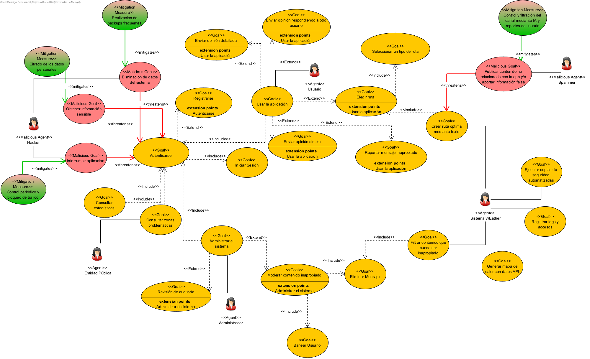

**Gestión de Proyectos Software**

# Concepto de Operaciones (ConOps)

**Grupo NeoForge**

**Proyecto WEather**

## Historial de Cambios

| Versión | Fecha | Secciones Modificadas | Descripción | Responsable |
|---|---|---|---|---|
| 0.0.1 | 23/09/26 | Todo | Creación y definición | Todos |
| 0.0.2 | 28/09/26 | Todo | Pulido de las diferentes secciones | Todos |
| 0.0.3 | 04/10/26 | Todo | Revisión general | Todos |
| 1.0.0 | 05/10/26 | Todo | Revisión final | Todos |

---

## 1. Introducción y Contexto

Durante los meses de altas temperaturas, las condiciones térmicas pueden variar considerablemente entre distintas zonas de una misma ciudad debido a factores como la sombra, la vegetación, el viento o el tipo de superficie. Los sistemas de navegación convencionales priorizan principalmente la distancia y el tiempo, sin considerar el confort térmico del desplazamiento. Por ello, proponemos WEather, una aplicación para Málaga que combina datos abiertos de mapas, meteorología y entorno urbano con las observaciones que aportan los propios usuarios.

Con estos datos, el servidor de WEather estima la exposición al calor y construye un mapa de calor propio que no se muestra al usuario: solo lo usa el cálculo de rutas. Sobre el mapa de OpenStreetMap, el usuario escribe un origen y un destino y recibe tres alternativas de rutas (la más corta, la más fresca y una equilibrada) para elegir entre confort térmico y distancia, con las indicaciones paso a paso en texto. Las aportaciones de los usuarios, como la sensación térmica o la presencia de sombra, complementan los datos externos y mejoran progresivamente las estimaciones creadas por WEather.

La inteligencia artificial se usará en el cálculo del mapa de calor combinando los factores urbanos y meteorológicos obtenidos de las APIs. Además, ayudará a la moderación de contenido subido por los usuarios, siendo capaz de descartar mensajes de texto, o marcar audios/imágenes como dudoso para la posterior aprobación o no de un administrador.

El sistema estará especialmente orientado a desplazamientos a pie o en bicicleta, pudiendo resultar útil para residentes, turistas y deportistas durante periodos de altas temperaturas.

### Equipo de Desarrollo

El proyecto lo desarrolla el grupo NeoForge, formado por:

| Integrante |
|---|
| Alejandro Cueto Díaz |
| Daniel Linares Bernal |
| Francisco Javier Jordá Garay |
| Mario Fernández Calderón |
| Julián David Lemus |
| Andrés Santaella González |
| Nicolai Pirela Olivo |
| Pablo Ortega Serapio |

---

## 2. Propósito del Sistema

El propósito de WEather es que los peatones de Málaga lleguen a su destino con la menor exposición al calor posible, eligiendo entre confort térmico y distancia, con estimaciones que mejoran gracias a las aportaciones de la comunidad de usuarios.

Las funciones con las que se consigue este propósito se describen en el alcance del sistema (sección 5) y en la descripción del producto (sección 6).

---

## 3. Definiciones

| Término | Definición |
|---|---|
| Actor | Persona, organización o sistema con objetivos propios respecto a WEather. |
| Agente Malicioso | Actor, real o antropomorfizado (por ejemplo, un proveedor que entrega datos erróneos), cuyo objetivo perjudica a un objetivo legítimo del sistema o de los usuarios. |
| Confort térmico | Condiciones térmicas de una ruta confortable para el usuario. |
| Horas de radiación alta | Franjas horarias en las que el índice UV previsto para Málaga es igual o superior a 6 (considerado alto según la OMS). |
| Mapa de calor (heatmap) | Representación de una zona según la exposición estimada de calor. |
| Crowdsourcing | Modelo de obtención de información mediante la participación y colaboración de usuarios mediante la aportación de datos u observaciones para mejorar la información en el sistema. |
| Reportes | Aportación de un usuario registrado sobre cómo percibe el calor en un punto del mapa: una valoración de 1 a 5 y un comentario de texto o mensaje de voz. |
| Geocodificación | Conversión de un texto (dirección o nombre de un lugar) en coordenadas de longitud y latitud. WEather la realiza con Nominatim. |
| Objetivo | Estado que un actor quiere alcanzar y que se cumple o no de forma clara. Se identifican como OBJ-Xnn, donde la letra indica el actor: U (usuario), S (sistema), A (administrador) y P (proveedores/APIs). |

---

## 4. Análisis de Partes y Objetivos

### 4.1. Partes interesadas

| Actor | Qué agrupa | Intereses |
|---|---|---|
| Usuario | Residentes, turistas, corredores y deportistas. | Quiere desplazarse por la ciudad con el menor calor posible. Todos los perfiles comparten ese objetivo; lo que cambia es la preferencia entre ruta fresca y corta. Los perfiles se describen en la sección 6.3. |
| Sistema WEather | App móvil, servidor (API propia), generador del mapa de calor, motor de rutas y moderación por IA. | Procesa los datos ambientales, estima la exposición, calcula las rutas e incorpora los reportes. |
| Administrador | Administradores del sistema, desarrollador y moderador de contenido. | Mantener la información veraz y el servicio disponible y seguro: revisa los reportes dudosos y gestiona copias de seguridad. |
| Proveedores de datos abiertos (APIs) | OpenStreetMap (mapa y calles), Nominatim, OSRM, Open-Meteo, AEMET y datos abiertos del Ayuntamiento de Málaga. | Suministran mapas, rutas y datos meteorológicos. Sus condiciones de uso (atribución, licencias y límites de peticiones) imponen restricciones reales al diseño. |
| AEPD (Agencia Española de Protección de Datos) |  | Vela por que el tratamiento de datos personales cumpla el RGPD y la LOPDGDD; hace explícitas esas obligaciones en el modelo. |
| Ayuntamiento de Málaga |  | Le interesan la movilidad sostenible y la salud pública, pero la coordinación con él es Won’t Have y ningún objetivo depende de él. Sus datos abiertos se usan como proveedores. |
| Protección Civil |  | Le interesan los avisos ante olas de calor, pero estos se toman de AEMET. |

### 4.2. Diagrama Tropos: Red de Dependencias de Actores y Objetivos del Sistema WEather

### 4.3. Objetivos

#### Usuario

| ID | Objetivo | Se cumple cuando… |
|---|---|---|
| OBJ-U01 | Llegar a destino con la menor exposición al calor | Recibe una ruta con menos exposición estimada que la más corta |
| OBJ-U02 | Llegar recorriendo la menor distancia | Siempre recibe la ruta más corta como referencia |
| OBJ-U03 | Seguir la ruta sin desorientarse | Recibe indicaciones en texto, paso a paso, con calle y distancia |
| OBJ-U04 | Elegir con información entre las alternativas | Ve la distancia, el tiempo y la exposición estimada de cada ruta antes de elegir |
| OBJ-U05 | Encontrar dónde refrescarse o descansar | Ve fuentes, parques y zonas de sombra cerca de su ruta |
| OBJ-U06 | Compartir cómo percibe el calor en un lugar | Envía una valoración de 1 a 5 y un comentario de texto o voz ligado a un punto del mapa |
| OBJ-U07 | Confiar en la información recibida | Las estimaciones y los reportes que ve están filtrados y contrastados |
| OBJ-U08 | Proteger sus datos y sus desplazamientos | Nadie puede saber quién reportó algo ni qué ruta pidió |
| OBJ-U09 | Usar la app en su idioma | La interfaz y las indicaciones están al menos en español e inglés |
| OBJ-U10 | Obtener reconocimiento por contribuir | Ve logros, rachas o reputación por sus reportes |
| OBJ-U11 | Saber si es prudente salir con el calor que hace | Ve el aviso oficial de calor vigente, si lo hay |

#### Sistema WEather

| ID | Objetivo | Se cumple cuando… |
|---|---|---|
| OBJ-S01 | Estimar la exposición al calor de los diferentes sectores de Málaga | Hay un valor de exposición por sector (mapa de calor interno, no visible), calculado con datos de las APIs y reportes validados y recalculado |
| OBJ-S02 | Localizar origen y destino a partir de texto | Convierte lo escrito en coordenadas de Málaga; si hay varias coincidencias, deja elegir |
| OBJ-S03 | Calcular tres rutas alternativas | Devuelve la ruta más corta, la más fresca y una equilibrada |
| OBJ-S04 | Dar indicaciones paso a paso en texto | Cada ruta trae su lista de maniobras con nombre de calle y metros |
| OBJ-S05 | Resumir cada alternativa | Muestra la distancia (m), el tiempo (min) y la exposición estimada de cada ruta |
| OBJ-S06 | Mantener los datos ambientales al día | Consulta las APIs externas cada hora y guarda el último dato válido |
| OBJ-S07 | Incorporar los reportes a la estimación | Los reportes validados ajustan el valor de su zona durante un tiempo limitado |
| OBJ-S08 | Mostrar puntos de descanso y agua | Señala fuentes, parques y zonas de sombra cerca de la ruta |
| OBJ-S09 | Guardar el historial de rutas y reportes | El usuario recupera sus consultas y reportes anteriores |
| OBJ-S10 | Ejecutar copias de seguridad automatizadas | Se hacen copias periódicas de forma automática y se ha restaurado una con éxito |
| OBJ-S11 | Registrar logs y accesos | Queda registro de los accesos y de los cambios de datos de usuarios y administradores |

#### Administrador

| ID | Objetivo | Se cumple cuando… |
|---|---|---|
| OBJ-A01 | Mantener la información veraz | Revisa los reportes marcados como dudosos y puede retirarlos o banear los usuarios |
| OBJ-A02 | Poder auditar lo ocurrido | Consulta desde el panel el registro de accesos y cambios |

#### Proveedores de datos / APIs

| ID | Objetivo | Se cumple cuando… |
|---|---|---|
| OBJ-P01 | Recibir atribución y respeto de su licencia | La app muestra © OpenStreetMap contributors y la atribución de Open-Meteo, AEMET y Ayto. de Málaga según sus licencias |
| OBJ-P02 | No ver sus servicios sobrecargados | Se respetan sus límites de peticiones y se cachean las respuestas |

#### AEPD (Agencia Española de Protección de Datos)

| ID | Objetivo | Se cumple cuando… |
|---|---|---|
| OBJ-E01 | Que el tratamiento de datos cumpla RGPD y LOPDGDD | Hay consentimiento, minimización, datos cifrados y los derechos del usuario se pueden ejercer |

### 4.4. Relaciones entre objetivos

| Conflicto | Por qué chocan | Decisión de diseño |
|---|---|---|
| OBJ-U01 Menor exposición «−» OBJ-U02 Menor distancia | Ir por la sombra suele alargar el camino. | Se ofrecen siempre tres rutas: la corta, la fresca y la equilibrada (OBJ-S03), cada una con su resumen (OBJ-S05). El usuario decide. |
| OBJ-U06 Compartir percepción «−» OBJ-U08 Proteger sus datos | Un reporte lleva lugar y hora; publicado con identidad, expone al usuario. | Los reportes se guardan anonimizados y se muestran agregados por zona y franja horaria, nunca con autor ni hora exacta. |
| OBJ-S07 Incorporar reportes «−» OBJ-U07 Confiar en la información | Cualquier usuario puede aportar reportes falsos o sin relación con la app que contaminen la estimación. | Solo los reportes validados ajustan el mapa de calor y durante un tiempo limitado; el contenido dudoso lo revisa el administrador (OBJ-A01). |
| OBJ-P02 No sobrecargar «−» OBJ-S06 Datos ambientales al día | Datos frescos piden muchas consultas y los proveedores las limitan. | Se consulta a los proveedores y se cachean las respuestas; nunca se les llama en cada petición del usuario. |

### 4.5. Agentes maliciosos y mitigaciones

| Agente malicioso | Objetivo malicioso | Amenaza a | Mitigado por |
|---|---|---|---|
| Hacker | MOBJ-01 Obtener información sensible | Autenticarse | MIT-01 Cifrado de los datos personales |
| Hacker | MOBJ-02 Interrumpir aplicación | Autenticarse | MIT-02 Control periódico y bloqueo de tráfico |
| Hacker | MOBJ-03 Eliminación de datos del sistema | Autenticarse | MIT-03 Realización de backups frecuentes |
| Spammer | MOBJ-04 Publicar contenido no relacionado con la app y/o aportar información falsa | Crear ruta óptima mediante texto | MIT-04 Control y filtración del canal mediante IA y reportes de usuario |

---

## 5. Alcance del Sistema

WEather dispone de los siguientes componentes software:

| Componente | Función |
|---|---|
| App móvil WEather | Interfaz de usuario. Cuenta con un mapa base de Málaga, búsqueda de origen y destino, tres opciones de ruta con indicaciones, envío de reportes y gestión de cuenta de usuario |
| Servidor WEather | Atiende a la app mediante HTTPS con JSON: geocodificación de trayecto, pide las rutas al motor de rutas, las valora con el mapa de calor, genera las indicaciones de ruta y gestiona reportes |
| Motor de rutas (OSRM) | El Open Source Routing Machine calcula las rutas, en la versión final cuenta con tres perfiles: ruta corta, fresca y equilibrada |
| Generador del heatmap | Funciona en segundo plano, donde periódicamente combina datos meteorológicos y reportes validados para asignar exposición térmica a cada tramo de calle |
| Panel de administración | Interfaz de los administradores. Usado para la revisión de reportes de usuario, bloqueo de usuarios, supervisión de copias… |

Las funcionalidades a presentar en las primeras versiones se priorizan empleando el sistema MoSCoW:

**Must Have:**

- Mostrar el mapa base de Málaga
- Generar un heatmap interno de Málaga.
- Generar rutas a partir de un punto de origen y uno de destino usando como criterio la ruta menos calurosa.
- Mostrar indicaciones de rutas mediante texto plano.
- Mostrar opciones de trayectos variados, permitiendo ponderar el recorrido más corto o la relación óptima entre temperatura y distancia.
- Protección de datos: consentimiento, cifrado de datos y seguridad reforzada
- Cuenta de usuario para reportar.
- Validación mínima antes de que un reporte afecte al mapa (límite por usuario y hora + contraste meteorológico).
- Moderación por el administrador: eliminar mensajes y banear usuarios.
- Mostrar atribución y respetar los límites de peticiones de las APIs por exigencia de OSM y Nominatim.

**Should Have:**

- Reportes por voz con transcripción.
- Reportar contenido inapropiado
- Filtrado y moderación de reportes de usuarios mediante IA.
- Mostrar distancias y tiempo estimado de cada ruta.
- Mostrar sitios donde refrescarse sobre el mapa.
- Mostrar puntos de interés sobre el mapa.
- Mostrar datos de interés como temperatura media, viento o cantidad de sombra sobre la ruta seleccionada por el usuario.
- Interfaz en español e inglés.
- Que el usuario pueda marcar mensajes inapropiados.
- Registro de accesos y revisión de auditoría.
- Creación de Backups
- Registro de auditoría

**Could Have:**

- Historial de rutas y reportes realizados por el usuario
- Sistema de valoración en forma de voto negativo o positivo a los reportes de otros usuarios
- Sistema de recompensas a usuarios.
- Ponderación general de reportes en una zona por reputación.
- Responder a opiniones de otros usuarios.
- Avisos oficiales de calor de AEMET.
- Rutas en bicicleta.
- Consulta de estadísticas.

**Won’t Have:**

- Cobertura fuera de Málaga.
- Monitorización y análisis del flujo peatonal.
- Pintar las rutas sobre el mapa.
- Ubicación en tiempo real o GPS
- Mostrar mapa de calor superpuesto en el mapa.

---

## 6. Descripción del producto

### 6.1. Concepto del Nuevo Sistema

Un usuario desea desplazarse por la ciudad de Málaga. Abre WEather y ve el mapa de la ciudad e introduce su origen y destino (una dirección o el nombre de un lugar, sin necesidad de GPS) y elige entre las coincidencias que le propone la aplicación. El sistema analiza las condiciones ambientales de las zonas que atraviesa la ruta consultando datos meteorológicos provistos por APIs externas (temperatura, humedad, viento) combinados con los datos de los reportes de los usuarios. A partir de esta información, WEather genera tres opciones: la ruta más corta, la más fresca y una equilibrada para que el usuario elija según sus preferencias de confort térmico, distancia o tiempo, recibiendo las indicaciones en formato de texto. Elige la que prefiere y la sigue leyendo las indicaciones; además, puede ver las fuentes, parques y zonas de sombra cercanas a su ruta.

Nuestra principal aportación es incorporar la experiencia real de los usuarios. Mediante reportes con una valoración de 1 a 5 y un comentario (evaluando la sensación térmica o la existencia de sombras concretas). Los reportes validados enriquecen y precisan las estimaciones generales de las APIs meteorológicas, permitiendo ofrecer indicaciones mucho más fiables y adaptadas a la realidad.

### 6.2. Perspectiva del producto

WEather es un producto independiente: no forma parte de un sistema mayor, pero depende de servicios externos de datos abiertos para el mapa, la geocodificación, las rutas y la meteorología.

La aplicación tendrá una interfaz general de usuario, donde se mostrará el mapa completo de Málaga. En él, el usuario podrá introducir puntos de origen y destino para generar rutas, así como ver puntos de interés y descanso. Habrá también una sección para crear reportes o novedades acerca del estado del clima, de las calles… Se proporcionará más funcionalidades y apartados de la interfaz para usuarios con roles con más permisos (administradores/desarrolladores).

#### 6.2.1. Interfaces del sistema

Los bloques de WEather se relacionan entre sí y con el exterior a través de las siguientes interfaces:

| Interfaz | Entre | Intercambio | Frecuencia |
|---|---|---|---|
| API de Weather | App móvil y servidor | Texto del trayecto, coincidencias, tres rutas con resumen e indicaciones, reportes y datos de la cuenta. | Según la acción del usuario / bajo demanda. |
| Teselas del mapa base | App móvil → servicio de mapas base | Imágenes de la zona visible | en cada acción del usuario y al mover el mapa, con caché |
| Geocodificación | Servidor → servicio externo de geocodificación | Servidor a servicio externo de geocodificación | En cada búsqueda |
| Cálculo de rutas | Servidor → motor externo de rutas | Coordenadas de origen y destino a rutas con distancia, tiempo y pasos | En cada búsqueda, con caché |
| Datos meteorológicos | servidor → fuentes meteorológicas externas y oficiales | Temperatura, temperatura aparente, radiación, nubosidad, viento y avisos | En cada consulta |
| Datos urbanos | Servidor → fuentes cartográficas abiertas y municipales | Árboles, parques, edificios, agua y fuentes | Cada hora; algunos datos, cada semana |
| Mapa de calor | Generador → servidor (y motor de rutas propio) | Un valor de exposición por tramo de calle | Cada hora |
| Administración | Panel de administración ↔ servidor | Reportes dudosos, bloqueos y registro de auditoría | Bajo demanda |

#### 6.2.2. Interfaces de usuario

| Vista | Características |
|---|---|
| Mapa | Pantalla inicial con el mapa de Málaga. Desde aquí se accede al buscador y a los reportes. |
| Buscador | Incluye dos campos de texto para introducir puntos de origen y destino. Al confirmar, se muestran coincidencias cercanas. Sin autocompletar. |
| Opciones de ruta | Se muestran tres tarjetas con las opciones de ruta corta, fresca y equilibrada, cada una con su distancia, tiempo y exposición térmica estimada. |
| Indicaciones de ruta | Pantalla que aparece con indicaciones en texto de la ruta seleccionada tras elegirla. |
| Reporte | Permite la selección de un punto del mapa, valoración, reporte por voz y comentario de texto. Requiere iniciar sesión. |
| Panel de administrador | Solo para administradores. Permite revisar reportes dudosos, moderación de usuarios, retirada de reportes y registro de auditoría |

#### 6.2.3. Interfaces de hardware

WEather no requiere hardware específico:

- Usuario: un teléfono móvil inteligente con conexión a Internet. El micrófono solo es necesario para los reportes de voz (Should). No se necesita GPS: el origen y el destino se escriben.
- Servidor: una máquina, física o virtual, capaz de ejecutar la API, la base de datos y el generador del mapa de calor

Se emplearán conexiones mediante HTTPS para proteger la información transmitida.

### 6.3. Tipos y Características de los Usuarios

El sistema WEather está orientado principalmente a viandantes de Málaga. No se requieren conocimientos técnicos avanzados para el uso de la aplicación, únicamente competencias básicas en el manejo de dispositivos móviles inteligentes y aplicaciones de navegación. Se han identificado como posibles tipos de usuarios los siguientes:

| Perfil | Características | Motivación para usar la app |
|---|---|---|
| Residente de Málaga | Vive o trabaja en la ciudad. Hace trayectos habituales casi diariamente y quiere evitar una exposición térmica prolongada | Uso frecuente y rápido. Busca rutas frescas hacia destinos que ya conoce. Realiza muchos reportes |
| Turista | No conoce las calles de la ciudad, ni puntos de interés o descanso ni el clima de la zona | Uso ocasional. Búsqueda de sitios concretos, puntos generales de descanso o rutas entre ellos |
| Deportista | Hace deporte varias veces por semana. Conoce las rutas, valora más confort térmico y encontrar puntos de sombra o hidratación | Uso frecuente. Busca rutas con temperatura agradable y con fuentes y sombras. Acepta rutas más largas si son más frescas. |

### 6.4. Limitaciones

Proporcionar una descripción general de cualquier otro elemento que vaya a limitar las opciones del proveedor.

- Políticas de regulación/Normativa:
  - La compañía tendría que adherirse a la normativa vigente en lo referente a la protección de datos. (Ley Orgánica 3/2018 de Protección de Datos Personales y garantía de los derechos digitales y el Reglamento General de Protección de Datos). El almacenamiento y uso de los datos personales de los usuarios, además de su ubicación o rutas deberá seguir la normativa.
  - Respecto al punto anterior, los usuarios deberán poder ejercer sus derechos en cuanto al almacenamiento de estos datos.
- Limitaciones de hardware:
  - Para obtener un servicio de mejor calidad y facilidad el usuario se beneficiaría de tener un móvil con GPS preciso, ya que si no se puede geolocalizar al usuario se tendría que recurrir a búsquedas de puntos por teclado, por ejemplo.
  - El usuario deberá tener una conexión a internet para utilizar el servicio, lógicamente no podrá alcanzar nuestro servicio provisto por servidores si no tiene una conexión estable. Incluso si los usuarios disponen de este requisito, dependemos de los proveedores de red, ya que estos no garantizan su funcionamiento en multitud de sitios, especialmente zonas rurales o subterráneas.
- Interfaces con otras aplicaciones:
  - El sistema requerirá una serie de conexiones basadas en interfaces que conectan el sistema con múltiples proveedores de diversos servicios, como de información del clima en tiempo real. Esto implica que nos regimos por las condiciones de estas APIs y por su disponibilidad.

    La calidad de nuestro servicio también será dependiente de la de nuestros proveedores externos de información.
- Operación en paralelo:
  - El sistema deberá permitir que múltiples usuarios la utilicen al mismo tiempo por lo que el sistema estará limitado por las capacidades de sus servidores en cuanto a la cuantía de tráfico que estos puedan soportar y la velocidad de sus respuestas.
- Funciones de auditoría:
  - El sistema para poder ejercer su función de accountability deberá poseer mecanismos que almacenen y graben los accesos, usos de la aplicación y diferentes modificaciones de datos, tanto las ejercidas por administradores como las realizadas por usuarios. Esto servirá para demostrar actuaciones indebidas y revertir sus acciones. La posesión de registros de uso en la aplicación también será útil en caso de algún ataque cibernético externo, ya que tras un ataque informático se podría investigar su origen y las acciones realizadas por el atacante en el sistema tanto para evaluar los daños realizados tras el hecho como para aprender a defender el sistema mejor en el futuro.
- Funciones de control:
  - La aplicación deberá tener un sistema de permisos que controle los accesos a la aplicación, pero en lo que respecta a limitaciones para proveer el servicio, dicho sistema impedirá parcialmente el uso de la aplicación por usuarios que no estén registrados, ya que algunas funciones como los reportes de uso por parte del usuario deberían tener una cuenta asociada para poder modelarlos.
- Requisitos de idioma:
  - La aplicación por su misión y su propósito está muy relacionada con usuarios que visiten las áreas donde la aplicación funcione y que no conozcan estos lugares como los residentes de larga estancia. Muchos de estos usuarios son turistas que pueden tener una proficiencia muy diversa en idiomas, por lo que la aplicación no podrá proveer un servicio óptimo a menos que ofrezca un amplio rango de idiomas.
- Requisitos de calidad:
  - El sistema debe ofrecer mapas detallados de las zonas con información de rutas eficientes guiadas por la temperatura de la zona, todo con texto fácil de leer.
- Seguridad y protecciones:
  - Se debe realizar una copia de seguridad de la base de datos periódicamente para evitar la pérdida de datos en casos extremos, así como mantener los datos personales de los usuarios cifrados para mayor protección.
- Otras consideraciones:
  - La utilidad de la aplicación depende de la localización en la que se use y su clima.
